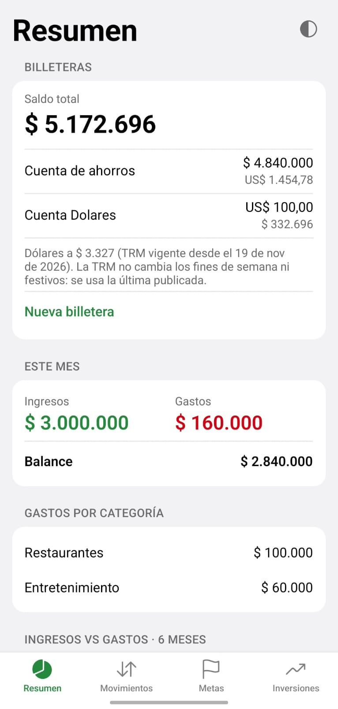
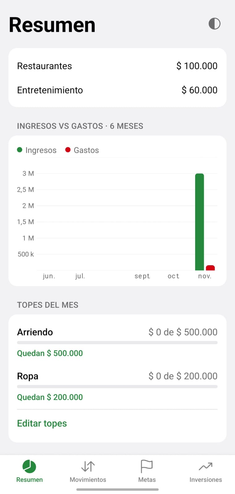
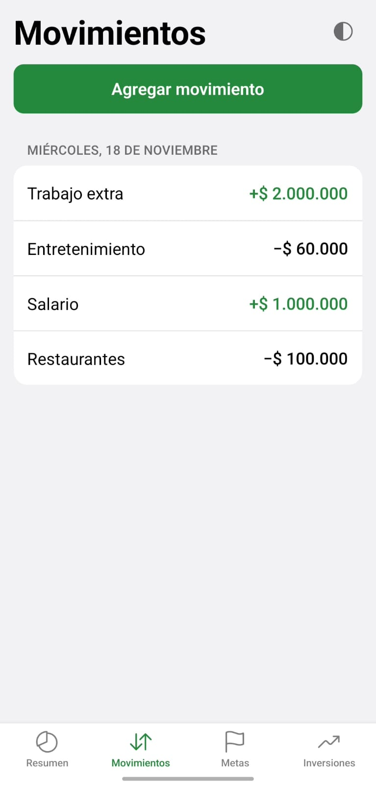
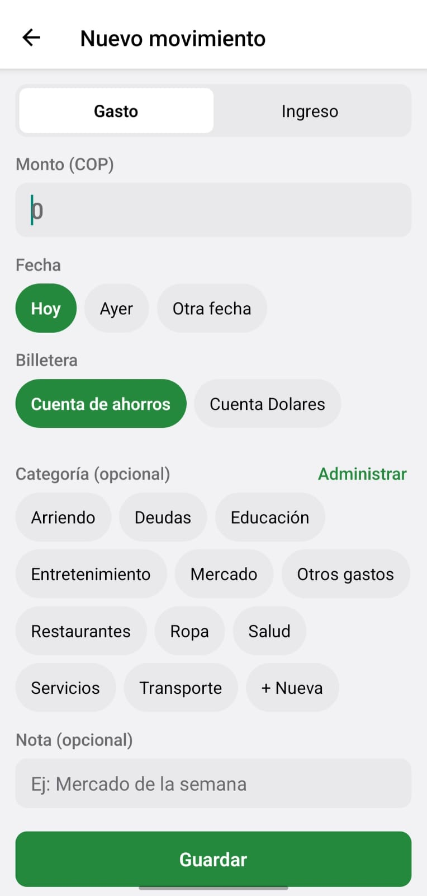
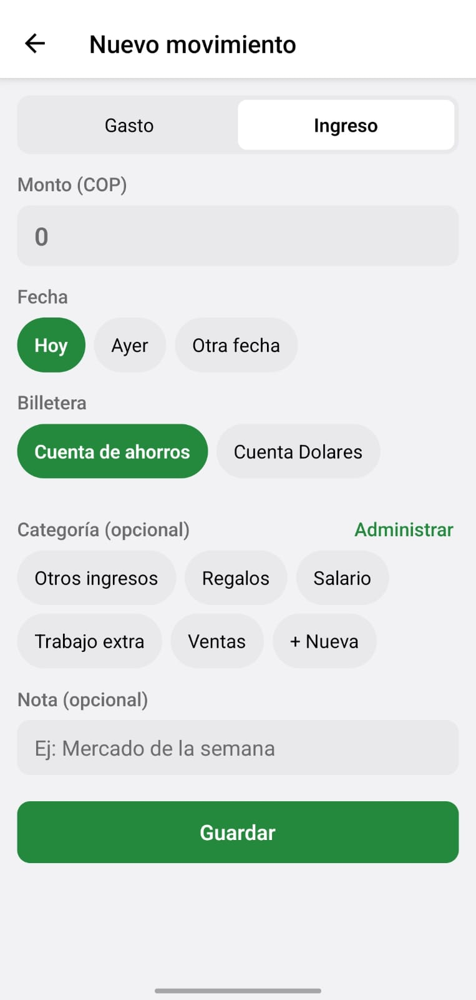
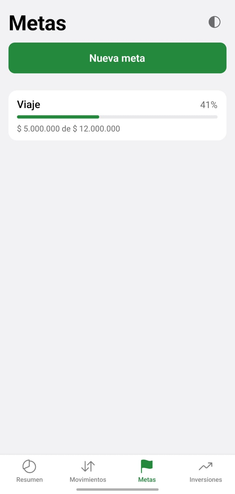
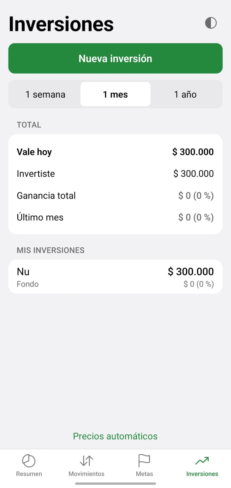
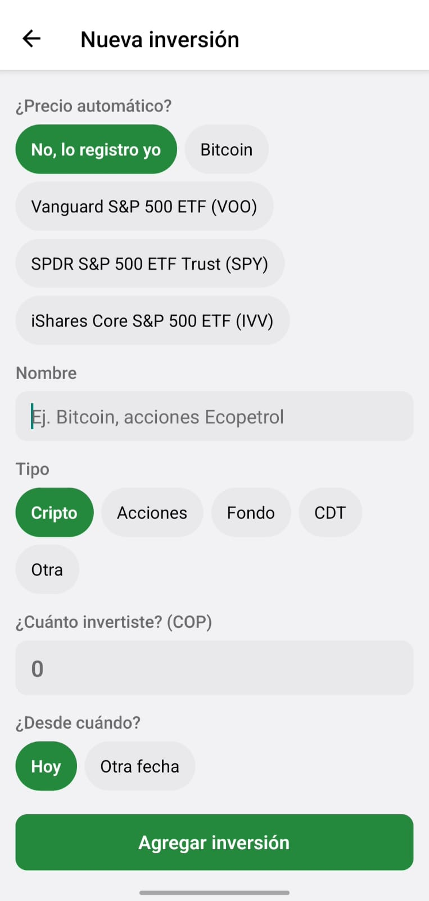

# Iris

Gestor de finanzas personales pensado para el celular: registra ingresos y gastos, fija topes por categoría, crea metas de ahorro y sigue tus inversiones.

Todo se guarda en tu celular: no hay servidor ni cuenta que crear.

**[Descargar la APK para Android](https://github.com/EdenIsakka/Iris/releases/latest)** (en _Assets_ del último release; solo Android).

## Capturas

<p>
  
  
  
  
</p>

<p>
  
  
  
  
</p>

## Stack

| Capa     | Tecnología                                       |
| -------- | ------------------------------------------------ |
| App      | Expo SDK 58, Expo Router, TanStack Query         |
| Datos    | SQLite en el celular (`expo-sqlite`), Drizzle    |
| Monorepo | pnpm workspaces, Turborepo                       |
| Calidad  | TypeScript strict, Biome, Vitest, GitHub Actions |

Las decisiones están documentadas como ADRs en [`docs/adr`](docs/adr).

## Estructura

```
apps/
  mobile/     App Expo (app/ = rutas, src/features = hooks y pantallas)
packages/
  db/         Esquema SQLite, migraciones y servicios
  shared/     Esquemas Zod + utilidades de dinero
  tsconfig/   Configuración TypeScript compartida
docs/adr/     Decisiones de arquitectura
```

## Correr en local

Requisitos: Node 22, pnpm y la app Expo Go en el celular.

```bash
pnpm install
pnpm dev
```

Escanea el código QR con Expo Go.

## Generar la APK

Con una cuenta de Expo (gratis) y el proyecto conectado con `eas init`:

```bash
cd apps/mobile
npx eas-cli@latest build --profile preview --platform android
```

EAS compila en la nube y da un enlace para bajar la APK, que se sube a GitHub Releases.

## Scripts

| Script           | Qué hace                                    |
| ---------------- | ------------------------------------------- |
| `pnpm dev`       | App en modo desarrollo                      |
| `pnpm lint`      | Biome (lint + formato)                      |
| `pnpm typecheck` | TypeScript en todos los workspaces          |
| `pnpm test`      | Pruebas (SQLite en memoria, sin nada extra) |
